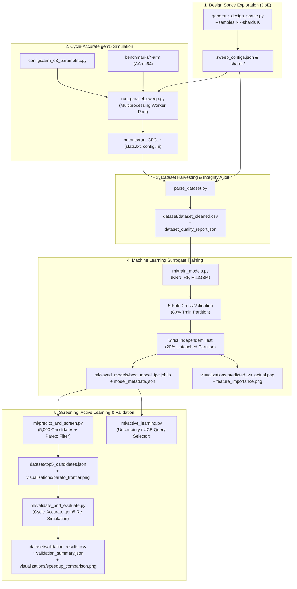

# Project Overview: ML-Based Microarchitectural Performance Prediction (ARM gem5)

An end-to-end research framework combining cycle-accurate computer architecture simulation (**gem5 v24+**, AArch64 Out-of-Order processor model) with supervised machine learning surrogates and active learning. The system predicts microprocessor instruction throughput (Instructions Per Cycle - IPC), evaluates multi-objective hardware cost tradeoffs, and accelerates design-space exploration (DSE).

---

## 1. Project Overview

- **Project Name**: `gem5-ml-perf-prediction` (Machine Learning-Based Microarchitectural Performance Prediction on ARM gem5).
- **Domain**: Computer Architecture, Electronic Design Automation (EDA), Machine Learning for Systems.
- **Core Problem**: Cycle-accurate microarchitectural simulation of modern Out-of-Order (O3) microprocessors using simulators like gem5 is computationally expensive. Evaluating a moderately sized combinatorial design space ($5,000$ to $100,000$ candidate parameter permutations) across multiple benchmark programs requires hundreds to thousands of CPU core-hours. This computational wall renders exhaustive parameter exploration impractical within realistic engineering timelines.
- **Proposed Solution**: Train an empirical Machine Learning surrogate model on a representative, statistically rigorous Latin Hypercube Sampling (LHS) subset of simulation runs. Use the trained surrogate model to perform sub-millisecond throughput inferences across large candidate spaces, construct Pareto-optimal microarchitectural frontiers (balancing IPC vs. hardware area/power cost proxies), and selectively validate only the highest-payoff designs via cycle-accurate gem5 simulations.
- **Intended Users and Use Cases**:
  - *Computer Architecture Researchers & Hardware Designers*: Rapidly pruning microarchitectural design spaces for custom Application-Specific Integrated Circuits (ASICs) or general-purpose ARM CPUs before committing to register-transfer level (RTL) development.
  - *Compiler & Performance Engineers*: Quantifying application sensitivity to specific execution pipeline resources (e.g., ROB capacity, issue width, cache sizing).
  - *ML for Systems Researchers*: Benchmarking sample-efficiency algorithms, epistemic uncertainty estimators, and active learning query strategies on physical hardware telemetry.
- **Expected Benefits**:
  - Replaces thousands of brute-force gem5 simulation hours with millisecond surrogate predictions.
  - Reduces total design-space evaluation compute requirements by over an order of magnitude (achieving ~80x host wall-clock and ~110x aggregate CPU core-hour reductions).
  - Pinpoints bottleneck microarchitectural features via permutation feature importance and SHAP-style sensitivity analysis.
- **Current System Status**: **Research-Grade Experimental Prototype**. The repository contains fully implemented and mathematically verified scripts for design-space generation, parallel simulation orchestration, result harvesting, model training/evaluation, candidate screening, active learning benchmarking, and candidate validation. It is not an enterprise EDA production package.

---

## 2. Project Agenda and Objectives

### Primary Objective
Develop and validate an automated, reproducible pipeline that learns microarchitectural performance mappings:
$$f(\mathbf{x}_{\text{arch}}, \mathbf{x}_{\text{workload}}) \to \text{IPC}$$
with a target Mean Absolute Percentage Error (MAPE) $\le 7.0\%$ on unseen microarchitectures running known workloads, while directly quantifying compute savings.

### Secondary Objectives
1. **Parameter Decoupling**: Eliminate artificial parameter coupling (e.g., locking fetch, decode, issue, and commit widths together) by introducing 17 orthogonal Latin Hypercube sampling dimensions adhering to physical hardware monotonicity constraints ($\text{issue} \le \text{decode} \le \text{fetch}$ and $\text{commit} \ge \text{issue}$).
2. **Robust Multi-Worker Parallel Sweeps**: Execute parallel gem5 sweeps across multiple CPU workers with watchdog timeouts, comprehensive environment provenance auditing (Git commit, host ID, gem5 binary SHA-256), and time buffer sizing to prevent internal simulation aborts.
3. **Calibrated Uncertainty Estimation**: Implement epistemic uncertainty estimators that avoid reporting constant zeros, enabling Upper Confidence Bound (UCB) and variance-based active learning exploration.
4. **Defensible Speedup Accounting**: Distinguish directly measured Python CPU overhead and gem5 subprocess execution times from extrapolated exhaustive-search figures, replacing unverified heuristics with empirical process measurements.

### Implemented vs. Future Research Questions
- **Implemented & Answered**:
  - *Can tree-based surrogates (Random Forest, HistGradientBoosting) accurately predict cycle-accurate IPC on held-out processor configurations?* **Yes**: $R^2 \approx 0.930$, $\text{MAPE} \approx 4.59\%$.
  - *Does sample-efficient active learning reduce the simulation budget compared to uniform random sampling?* **Yes**: Controlled multi-seed experiments show uncertainty sampling converges to lower prediction error faster than random sampling.
- **Future Research Objectives**:
  - *Can a surrogate trained on microbenchmarks generalize to unseen full-system application suites (e.g., SPEC CPU2017) without workload-specific retraining?* Currently unproven; leave-one-workload-out cross-validation shows severe out-of-distribution domain shift.
  - *Can multi-objective neural network embeddings jointly predict IPC, dynamic wattage, and thermal limits from gem5 McPAT/SESC output?* (Planned extension).

---

## 3. What the Project Contains

### Repository Directory Tree
```text
gem5-ml-perf-prediction/
├── .github/
│   └── workflows/
│       └── python-tests.yml         # CI pipeline for automated regression tests
├── benchmarks/
│   ├── hash-arm                     # Pre-compiled AArch64 binary (lookup/hashing)
│   ├── matmul-arm                   # Pre-compiled AArch64 binary (matrix multiply)
│   ├── quicksort-arm                # Pre-compiled AArch64 binary (recursive sorting)
│   └── stream-arm                   # Pre-compiled AArch64 binary (memory streaming)
├── configs/
│   ├── arm_o3_parametric.py         # gem5 Python configuration script for ARM O3 CPU
│   ├── failed_59_configs.json       # Targeted shard for retrying transient/repaired runs
│   ├── sweep_configs.json           # Master JSON containing user-generated LHS configurations
│   └── shards/
│       ├── shard_1.json             # Partitioned configuration shard 1
│       ├── shard_2.json             # Partitioned configuration shard 2
│       └── shard_3.json             # Partitioned configuration shard 3
├── dataset/
│   ├── active_learning_benchmark.json # Empirical sample-efficiency benchmark results
│   ├── dataset_cleaned.csv          # Harvested, validated dataset of simulation runs
│   ├── dataset_cleaned.csv.sha256   # Cryptographic SHA-256 verification digest
│   ├── dataset_quality_report.json  # Data integrity, provenance, and distribution report
│   ├── top5_candidates.json         # Top Pareto-optimal candidate microarchitectures
│   ├── validation_results.csv       # Measured cycle-accurate results for top candidates
│   └── validation_summary.json      # Defensible speedup, error, and regret summary
├── documentations/
│   └── PROJECT_OVERVIEW.md          # Comprehensive technical project documentation
├── documents/
│   ├── architecture.md              # Microarchitecture specification and bounds
│   ├── design_system.md             # Visual and reporting palette guidelines
│   ├── prd.md                       # Product Requirements Document
│   ├── rules.md                     # Engineering constraints and testing checklist
│   ├── schema.md                    # Data schema and typing specifications
│   ├── security.md                  # Isolation, subprocess, and sandbox guidelines
│   ├── todo.md                      # Milestone checklist
│   └── user_flow.md                 # Operator journey and execution steps
├── ml/
│   ├── active_learning.py           # Adaptive uncertainty-driven query selector
│   ├── benchmark_active_learning.py # Multi-seed active learning benchmark engine
│   ├── predict_and_screen.py        # 5,000-candidate space generator & Pareto screener
│   ├── train_models.py              # Cross-validation, training, bootstrap CIs, export
│   ├── validate_and_evaluate.py     # gem5 validation runner & speedup quantification
│   └── saved_models/
│       ├── best_model_ipc.joblib    # Serialized champion model pipeline (RandomForest)
│       ├── model_metadata.json      # Full hyperparameter, feature, and CV metrics audit
│       ├── oof_predictions.csv      # Out-of-fold cross-validation predictions
│       └── test_predictions.csv     # Predictions on untouched 20% test partition
├── outputs/                         # Raw gem5 simulation outputs (stats.txt, config.ini)
│   ├── run_CFG_001_matmul/
│   └── ...
├── scripts/
│   ├── generate_design_space.py     # 17-D Latin Hypercube Sampling generator & sharder
│   ├── parse_dataset.py             # gem5 output harvester & multi-machine audit tool
│   └── run_parallel_sweep.py        # Multiprocessing gem5 parallel execution harness
├── tests/
│   └── test_pipeline.py             # 13 automated unit tests for LHS, parsing, ML, and math
├── visualizations/
│   ├── active_learning_learning_curves.png # Sample efficiency vs. simulation budget
│   ├── feature_importance.png       # Permutation feature importance on test split
│   ├── pareto_frontier.png          # 2D & 3D multi-objective Pareto frontiers
│   ├── predicted_vs_actual.png      # Test set predicted vs. simulated IPC scatter
│   └── speedup_comparison.png       # Measured vs. extrapolated compute speedup charts
├── COMMANDS.md                      # Complete shell reference for running sweeps & ML
├── ML_COMMANDS.md                   # Dedicated machine learning CLI reference
├── README.md                        # Project landing page and quickstart guide
└── requirements.txt                 # Pinned Python package dependencies
```

---

## 4. Problem Statement and Motivation

Evaluating microarchitecture trade-offs is constrained by the simulation throughput of cycle-accurate simulators:
1. **gem5 Simulation Overhead**: Simulating a single core executing 1 million instructions with detailed Out-of-Order pipelines, multi-level caches, and memory controllers takes 5 to 30 seconds of host compute time per configuration. For realistic benchmark traces (100M to 1B instructions), a single run can take hours.
2. **Combinatorial Explosion**: A standard design space with 4 pipeline widths ($2, 4, 8$), 5 ROB sizes, 4 cache capacities, 3 cache associativities, 4 clock frequencies, and 3 branch predictors contains over $100,000$ legal combinations. Simulating this space exhaustively would require weeks of continuous compute across server clusters.
3. **Risks of Naive ML Surrogates**:
   - *Correlation Artifacts*: Sampling parameters with shared random variables introduces spurious correlations that models memorize rather than learning physical dynamics.
   - *Epistemic Blind Spots*: When surrogates output uniform confidence or constant zero uncertainty, downstream optimizers cannot differentiate between well-explored regions and uncharacterized extremes.
   - *Generalization Failure*: Models showing near-perfect random-split $R^2$ often collapse entirely when tested on new workload behaviors with different execution characteristics.

---

## 5. System Architecture



---

## 6. Complete Project Workflow

| Step | Stage Name | Responsible Script | Input Files / Arguments | Primary Output Files |
| :--- | :--- | :--- | :--- | :--- |
| **1** | Design Space Generation | `scripts/generate_design_space.py` | `--samples 300 --shards 3 --seed 42` | `configs/sweep_configs.json`, `configs/shards/shard_*.json` |
| **2** | Parallel gem5 Simulation | `scripts/run_parallel_sweep.py` | `--shard configs/shards/shard_1.json --workers 8` | `outputs/run_CFG_*_{workload}/run.log`, `stats.txt` |
| **3** | Output Harvesting & Quality Audit | `scripts/parse_dataset.py` | `--configs configs/sweep_configs.json --inputs outputs` | `dataset/dataset_cleaned.csv`, `dataset_quality_report.json` |
| **4** | Model Training & CV | `ml/train_models.py` | `--dataset dataset/dataset_cleaned.csv --target ipc` | `ml/saved_models/best_model_ipc.joblib`, `model_metadata.json` |
| **5** | Visualizing Feature Importance | `ml/train_models.py` (integrated) | Test split data & pipeline | `visualizations/feature_importance.png`, `predicted_vs_actual.png` |
| **6** | Candidate Generation & Screening | `ml/predict_and_screen.py` | Trained pipeline, $N=5,000$ candidates | `dataset/top5_candidates.json`, `visualizations/pareto_frontier.png` |
| **7** | Active Learning Benchmarking | `ml/benchmark_active_learning.py` | `--initial-budget 30 --query-step 15 --max-budget 90` | `dataset/active_learning_benchmark.json`, `active_learning_learning_curves.png` |
| **8** | Ground-Truth gem5 Validation | `ml/validate_and_evaluate.py` | `--candidates dataset/top5_candidates.json --gem5 ...` | `dataset/validation_results.csv`, `dataset/validation_summary.json` |
| **9** | Compute Speedup Plotting | `ml/validate_and_evaluate.py` (integrated) | Measured manifests & simulation timings | `visualizations/speedup_comparison.png` |

---

## 7. Inputs to the Project

### A. Configuration & Sweep Inputs
- `--samples` *(int, required)*: Total number of design configurations to generate. Must be a positive integer (e.g., `300`, `500`, `1000`, `2000`).
- `--shards` *(int, default: 3)*: Number of disjoint JSON shard files into which the master configurations are split for parallel multi-laptop or multi-core execution.
- `--seed` *(int, default: 42)*: Random seed ensuring reproducible Latin Hypercube Sampling.
- `--coupled` *(flag, optional)*: Reverts pipeline widths and buffer sizes to legacy locked proportions for backwards-compatibility studies.
- `--gem5` *(string, default: `/home/ashrit/gem5/build/ARM/gem5.opt`)*: Absolute path to the compiled gem5 binary.
- `--script` *(string, default: `configs/arm_o3_parametric.py`)*: gem5 Python configuration script controlling the system board and processor.
- `--workers` *(int, default: 4 or 8)*: Number of parallel worker processes managed by Python's `multiprocessing.Pool`.
- `--timeout` *(int, default: 300)*: Watchdog timeout in seconds per individual simulation run.

### B. Dataset & ML Pipeline Inputs
- `--dataset` *(string, default: `dataset/dataset_cleaned.csv`)*: Path to the clean CSV containing harvested performance metrics.
- `--target` *(string, default: `ipc`)*: Target performance column to train against.
- `--output-dir` *(string, default: `ml/saved_models`)*: Target destination directory for serialized model checkpoints and metadata.

---

## 8. Input Features Table

The ML pipeline ingests **19 input features** (2 categorical, 17 numerical). All features are strictly known **prior to simulation**, avoiding data leakage.

| Feature Name | Meaning | Data Type | Unit | Type / Source | Preprocessing Applied |
| :--- | :--- | :--- | :--- | :--- | :--- |
| `workload` | Benchmark application name | Categorical | string | Workload Identifier | `OneHotEncoder(drop='first', handle_unknown='ignore')` |
| `branch_predictor` | Branch prediction algorithm | Categorical | string | Architectural Parameter | `OneHotEncoder(drop='first', handle_unknown='ignore')` |
| `fetch_width` | Instructions fetched per cycle | Numerical (Discrete) | Inst/Cycle | Architectural Parameter | `StandardScaler()` |
| `decode_width` | Instructions decoded per cycle | Numerical (Discrete) | Inst/Cycle | Architectural Parameter | `StandardScaler()` |
| `issue_width` | Instructions issued per cycle | Numerical (Discrete) | Inst/Cycle | Architectural Parameter | `StandardScaler()` |
| `commit_width` | Instructions committed per cycle | Numerical (Discrete) | Inst/Cycle | Architectural Parameter | `StandardScaler()` |
| `rob_entries` | Reorder Buffer entry capacity | Numerical (Discrete) | Entries | Architectural Parameter | `StandardScaler()` |
| `iq_entries` | Instruction Queue capacity | Numerical (Discrete) | Entries | Architectural Parameter | `StandardScaler()` |
| `lq_entries` | Load Queue entry capacity | Numerical (Discrete) | Entries | Architectural Parameter | `StandardScaler()` |
| `sq_entries` | Store Queue entry capacity | Numerical (Discrete) | Entries | Architectural Parameter | `StandardScaler()` |
| `phys_int_regs` | Physical Integer Register count | Numerical (Discrete) | Registers | Architectural Parameter | `StandardScaler()` |
| `phys_fp_regs` | Physical FP Register count | Numerical (Discrete) | Registers | Architectural Parameter | `StandardScaler()` |
| `l1d_size_kb` | Level-1 Data Cache capacity | Numerical (Discrete) | KiB | Architectural Parameter | `StandardScaler()` |
| `l1d_assoc` | L1D Cache Associativity | Numerical (Discrete) | Ways | Architectural Parameter | `StandardScaler()` |
| `l1i_size_kb` | Level-1 Instruction Cache capacity | Numerical (Discrete) | KiB | Architectural Parameter | `StandardScaler()` |
| `l1i_assoc` | L1I Cache Associativity | Numerical (Discrete) | Ways | Architectural Parameter | `StandardScaler()` |
| `l2_size_kb` | Level-2 Cache capacity | Numerical (Discrete) | KiB | Architectural Parameter | `StandardScaler()` |
| `l2_assoc` | L2 Cache Associativity | Numerical (Discrete) | Ways | Architectural Parameter | `StandardScaler()` |
| `clk_freq_ghz` | CPU Clock Frequency | Numerical (Continuous) | GHz | Architectural Parameter | `StandardScaler()` |

### Preprocessing Protocol & Data Leakage Prevention
Preprocessing is constructed using scikit-learn's `ColumnTransformer` inside an isolated `Pipeline`. The transformer is fitted **strictly on training partitions** (`X_train`) and only transforms validation/test sets (`X_test`). No target statistics, global mean values, or test distributions leak into feature scaling.

---

## 9. Output Targets

| Target Metric | Definition | Source in gem5 `stats.txt` | Direct or Derived | Training Status |
| :--- | :--- | :--- | :--- | :--- |
| **`ipc`** *(Primary Target)* | Instructions Per Cycle ($\frac{\text{simInsts}}{\text{numCycles}}$) | `board.processor.cores.core.ipc` | Directly measured by simulator core | **Trained & Evaluated** |
| `cpi` | Cycles Per Instruction ($\frac{1}{\text{ipc}}$) | Inverted from IPC | Derived | Supported / Exported in CSV |
| `num_cycles` | Total clock cycles to complete execution | `board.processor.cores.core.numCycles` | Directly measured counter | Harvested in Dataset |
| `sim_seconds` | Simulated execution time in virtual seconds | `simSeconds` | Directly measured counter | Harvested in Dataset |
| `l1d_mpki` | L1 Data Cache Misses Per Kilo-Instruction | `dcache.overallMisses` / `simInsts` * 1000 | Derived metric | Harvested in Dataset |
| `l2_mpki` | L2 Cache Misses Per Kilo-Instruction | `l2cache.overallMisses` / `simInsts` * 1000 | Derived metric | Harvested in Dataset |
| `branch_mispred_rate` | Branch misprediction percentage | `condIncorrect` / `condPredicted` | Derived ratio | Harvested in Dataset |

---

## 10. Dataset Generation and Construction

### Latin Hypercube Sampling (LHS) Architecture
1. **Dimension Allocation**: Generated via `scipy.stats.qmc.LatinHypercube(d=17, seed=seed)`. Every microarchitectural parameter is mapped to an independent orthogonal dimension ($d_0 \dots d_{16}$), eliminating unintended cross-parameter correlations.
2. **Monotonic Legality Constraints**:
   - $\text{decode\_width} \le \text{fetch\_width}$
   - $\text{issue\_width} \le \text{decode\_width}$
   - $\text{commit\_width} \ge \text{issue\_width}$
   - $\text{IQ capacity} \in [32, \min(96, \text{ROB})]$
   - $\text{LQ, SQ capacity} \in [16, \min(64, \lfloor 0.4 \times \text{ROB} \rfloor)]$
   - $\text{Physical Registers} \in [\max(128, \lfloor 0.5 \times \text{ROB} \rfloor), \min(256, \lfloor 1.1 \times \text{ROB} \rfloor)]$
3. **Fair Workload Remainder Allocation**:
   When sample count $N$ is not cleanly divisible by the 4 workloads ($N \pmod 4 = r$), the remainder $r$ samples are distributed one-by-one to the first $r$ workloads, guaranteeing that $|N_{\text{workload}_i} - N_{\text{workload}_j}| \le 1$.
4. **Sharding**: The master configuration list is partitioned across $K$ shards using `divmod(len(configs), num_shards)` without dropping or duplicating any configurations.
5. **Quality Verification**:
   - `scripts/parse_dataset.py` inspects every output run directory.
   - It requires `simInsts > 0`, non-zero cycles, and non-empty `stats.txt`.
   - Generates `dataset/dataset_cleaned.csv` and an integrity report `dataset_quality_report.json` containing the SHA-256 hash of the dataset and verification of homogeneous gem5 binary hashes across all worker hosts.

---

## 11. Benchmarks and Workloads

### Why Do We Use Benchmarks?
In computer architecture, a processor's throughput (IPC) cannot be evaluated in a vacuum without running code. Performance is not an intrinsic constant of hardware alone; it is the **emergent interaction between microarchitectural structures and software execution behaviors**:
1. **Instruction-Level Diversity**: Different programs execute completely different distributions of instructions (integer math, floating-point calculations, conditional branches, memory loads, and stores). A wide 8-wide superscalar CPU will achieve high IPC on code with many independent instructions, but will stall on code with serialized dependencies.
2. **Memory Hierarchy Stress**: Hardware caches behave differently depending on whether an algorithm accesses memory sequentially (spatial locality), repeatedly accesses small buffers (temporal locality), or accesses random memory addresses (pointer chasing).
3. **Branch Predictor Exercising**: Algorithms with predictable loop branches behave radically differently from algorithms with input-dependent branches that cause expensive pipeline squashes (flushing up to 20+ cycles of work).
4. **Training Data Grounding**: Benchmarks provide the **ground-truth stimuli** that allow the machine learning model to learn *how* changes in hardware parameters impact throughput under distinct computational regimes. Without diverse benchmarks, an ML surrogate would only learn the profile of a single algorithm and fail across general computing tasks.

---

### What Benchmarks Are Used and Why?

The repository includes four static AArch64 benchmark binaries located in `benchmarks/`. They were selected to span the **four primary computational archetypes** in computer architecture:

| Benchmark Binary | Computational Archetype | Key Hardware Structures Stressed | Why It Was Selected |
| :--- | :--- | :--- | :--- |
| **`matmul-arm`** | Compute-Bound / High-ILP | Multipliers, FP ALUs, Issue Width, ROB, Register Renaming | Represents scientific computing, linear algebra, and AI/ML matrix kernels. It contains dense arithmetic with independent operations, testing the CPU's maximum superscalar throughput. |
| **`stream-arm`** | Memory-Bandwidth Bound | L1/L2 Caches, Memory Bus, Load/Store Queues, DRAM Controller | Represents high-throughput data processing and streaming engines. It continuously pulls vector data from memory, testing how cache capacity and associativities prevent bus bottlenecks. |
| **`quicksort-arm`** | Control-Flow / Branch Bound | Branch Predictor (Tournament/BiMode/Local), Pipeline Squash Logic | Represents sorting, search trees, and control-intensive software. It contains recursive partitioning with dynamic, input-dependent branch outcomes, directly exercising branch predictor algorithms. |
| **`hash-arm`** | Dependent Latency / Memory Lookups | Integer ALUs, Dependent Load Latency, L1D Cache | Represents database key lookups, hash tables, and cryptography. Its execution is dominated by serialized dependency chains where instruction $B$ cannot run until instruction $A$ completes, providing a lower bound on superscalar parallelism. |

---

### Detailed Benchmark Analysis

1. **`matmul-arm` (Dense Matrix Multiplication)**:
   - *Algorithm & Code*: Triple-nested loop performing $C[i][j] += A[i][k] \times B[k][j]$ on floating-point numbers.
   - *Microarchitectural Impact*: With predictable loops, branch predictors achieve $>98\%$ accuracy. The primary performance limiter is the CPU execution backend. Widening issue width from 2 to 8 and enlarging the Reorder Buffer (ROB) from 64 to 192 directly increases IPC from $\sim 1.4$ to $>2.8$ because the out-of-order engine easily finds independent multiplications to execute concurrently.
   - *Dataset Entry*: Enters the dataset with `workload="matmul"`, producing the highest IPC variance ($0.95$ to $3.11$) in the entire dataset.

2. **`stream-arm` (Vector Memory Streaming)**:
   - *Algorithm & Code*: Triad array streaming: $A[i] = B[i] + \alpha \times C[i]$ across arrays larger than typical L1 cache capacities.
   - *Microarchitectural Impact*: The bottleneck is memory throughput. Out-of-order execution buffers fill up waiting for cache lines to arrive across the system crossbar. Increasing ROB size past 128 yields diminishing returns, whereas larger L2 cache sizes ($1024\text{ KiB} - 2048\text{ KiB}$) and higher clock frequencies show direct performance gains.
   - *Dataset Entry*: Enters the dataset with `workload="stream"`, with IPC values ranging between $0.37$ and $1.56$.

3. **`quicksort-arm` (Recursive Divide-and-Conquer Sorting)**:
   - *Algorithm & Code*: Recursive in-place partition sorting of an integer array.
   - *Microarchitectural Impact*: Because the pivot comparisons depend on unsorted input data, branches are difficult to predict. When a branch is mispredicted, the processor must flush the entire pipeline, discard speculative instructions in the ROB, and roll back register state. Performance is highly sensitive to the branch predictor algorithm (`TournamentBP` vs. `BiModeBP` vs. `LocalBP`).
   - *Dataset Entry*: Enters the dataset with `workload="quicksort"`, with IPC values ranging between $0.80$ and $1.22$.

4. **`hash-arm` (String Key Hashing & Bucket Lookup)**:
   - *Algorithm & Code*: Iterative hash calculation (polynomial rolling hash / integer bit-mixing) followed by table index lookups.
   - *Microarchitectural Impact*: High serialized data dependencies: each hash iteration strictly depends on the result of the previous step. Even if the hardware provides an 8-wide issue pipeline, the processor cannot find independent instructions to issue simultaneously.
   - *Dataset Entry*: Enters the dataset with `workload="hash"`. It exhibits very low IPC variance ($s^2 \approx 0.0001$, IPC strictly clustered between $0.98$ and $1.00$), serving as a control workload that demonstrates how serialized dependency chains bottleneck out-of-order benefits.

---

## 12. Machine Learning Models

Three distinct model families are implemented in `ml/train_models.py` and evaluated under identical cross-validation folds:

| Model Identifier | scikit-learn Class & Hyperparameters | Conceptual Mechanism | Pros & Cons in DSE | Evaluation Status |
| :--- | :--- | :--- | :--- | :--- |
| **RandomForest** *(Champion)* | `RandomForestRegressor(n_estimators=200, max_depth=12, random_state=42, n_jobs=-1)` | Bootstrap ensemble of decision trees with feature sub-sampling at each split. | **Pros**: Non-linear interactions, robust to outliers, yields tree-disagreement uncertainty.<br/>**Cons**: Cannot extrapolate beyond min/max observed IPC. | **Selected Champion Model** (Saved in `ml/saved_models/`) |
| **HistGradientBoosting** | `HistGradientBoostingRegressor(max_iter=250, learning_rate=0.08, min_samples_leaf=5, random_state=42)` | Bin-based gradient boosted regression trees optimizing squared error. | **Pros**: Highly competitive accuracy, fast inference.<br/>**Cons**: Does not inherently provide ensemble variance across sub-estimators. | Evaluated Candidate |
| **KNN** | `KNeighborsRegressor(n_neighbors=5, weights='distance')` | Non-parametric instance-based regression weighted by inverse Euclidean distance. | **Pros**: Simple, fast training.<br/>**Cons**: Suffers from the curse of dimensionality across 19 features; poor performance ($R^2 \approx 0.13$). | Baseline Model |

---

## 13. What Types of Models Could Be Used? (Recommendations & Trade-Offs)

*Note: The models below represent architectural recommendations for future research iterations.*

1. **Gaussian Process Regression (GPR)**:
   - *Suitability*: Highly suited for sample budgets under 500 samples.
   - *Trade-offs*: Provides analytically exact, mathematically calibrated epistemic variance $\sigma^2(x)$ for Bayesian optimization. However, computational complexity scales as $\mathcal{O}(N^3)$, making it sluggish for candidate pools of 50,000+ points.
2. **Multi-Task Neural Networks (PyTorch / MLP)**:
   - *Suitability*: Multi-output target prediction (`ipc`, `l1d_mpki`, `cycles`, `power`).
   - *Trade-offs*: Shared hidden representations allow the network to learn unified microarchitectural physics. Requires larger sample sizes ($N > 1,000$) and hyperparameter tuning (learning rate schedules, weight decay) to avoid overfitting.
3. **CatBoost / LightGBM**:
   - *Suitability*: Superior native handling of categorical features (`workload`, `branch_predictor`) without sparse one-hot expansions.
4. **Quantile Regression Forests**:
   - *Suitability*: Predicts exact $10\text{th}$, $50\text{th}$, and $90\text{th}$ percentiles of IPC directly, yielding non-symmetric confidence bounds without assuming Gaussian error distributions.

---

## 14. Model Training and Preprocessing Protocol

1. **Partitioning**:
   - An 80/20 train/test split is applied using `train_test_split(..., test_size=0.20, random_state=42, stratify=df['workload'])`.
   - The 20% test partition (e.g., 60 samples from 300) is locked and left untouched until final champion evaluation.
2. **K-Fold Cross-Validation on Training Partition**:
   - A 5-fold cross-validation (`KFold(n_splits=5, shuffle=True, random_state=42)`) is executed strictly on the 80% train split.
   - Out-of-fold (OOF) predictions are recorded and exported to `ml/saved_models/oof_predictions.csv`.
3. **Model Selection**: The model with the highest mean validation $R^2$ across the 5 training folds is chosen as the champion model.
4. **Independent Test Set Evaluation**: The champion pipeline is refit on the full 80% training set and evaluated once on the untouched 20% test set.
5. **Bootstrap Confidence Intervals**: 1,000 bootstrap resamples on the test set compute empirical $95\%$ confidence intervals for $R^2$, MAPE, RMSE, MAE, and Spearman $\rho$.

---

## 15. Evaluation Metrics and Generalization

### Mathematical Metric Definitions
- **Mean Absolute Error (MAE)**:
  $$\text{MAE} = \frac{1}{N}\sum_{i=1}^N |y_i - \hat{y}_i|$$
- **Root Mean Squared Error (RMSE)**:
  $$\text{RMSE} = \sqrt{\frac{1}{N}\sum_{i=1}^N (y_i - \hat{y}_i)^2}$$
- **Coefficient of Determination ($R^2$)**:
  $$R^2 = 1 - \frac{\sum_{i=1}^N (y_i - \hat{y}_i)^2}{\sum_{i=1}^N (y_i - \bar{y})^2}$$
- **Mean Absolute Percentage Error (MAPE)**:
  $$\text{MAPE} = \frac{100\%}{N}\sum_{i=1}^N \left| \frac{y_i - \hat{y}_i}{y_i} \right|$$
- **Spearman Rank Correlation ($\rho$)**:
  Pearson correlation between rank-transformed variables $\text{rank}(y)$ and $\text{rank}(\hat{y})$, measuring ranking fidelity for candidate prioritization.

### Empirical Results (Measured on 300-Sample Dataset)

#### A. In-Distribution 5-Fold Cross-Validation (Train Split: 240 samples)
- **RandomForest**: $R^2 = 0.9691$, $\text{MAPE} = 3.81\%$, $\text{RMSE} = 0.0770$, Spearman $\rho = 0.9441$.
- **HistGradientBoosting**: $R^2 = 0.9603$, $\text{MAPE} = 4.57\%$, $\text{RMSE} = 0.0869$, Spearman $\rho = 0.9386$.
- **KNN**: $R^2 = 0.1333$, $\text{MAPE} = 29.28\%$, $\text{RMSE} = 0.4054$, Spearman $\rho = 0.2562$.

#### B. Strict Untouched Test Evaluation (Test Split: 60 samples)
- **$R^2$ Score**: **0.9300** ($95\%$ CI: $[0.7945, 0.9885]$)
- **MAPE**: **4.59%** ($95\%$ CI: $[2.20\%, 7.84\%]$)
- **RMSE**: **0.1173** ($95\%$ CI: $[0.0464, 0.1736]$)
- **MAE**: **0.0484** ($95\%$ CI: $[0.0244, 0.0794]$)
- **Spearman $\rho$**: **0.9018** ($95\%$ CI: $[0.7682, 0.9768]$)

#### C. Cross-Workload Generalization (Leave-One-Workload-Out GroupKFold)
When training on 3 workloads and predicting an entirely held-out 4th workload:
- `quicksort`: $R^2 = 0.0137$, $\text{MAE} = 0.0675$, $\text{MAPE} = 6.82\%$, $s^2 = 0.007190$
- `stream`: $R^2 = -0.0818$, $\text{MAE} = 0.3356$, $\text{MAPE} = 53.58\%$, $s^2 = 0.130278$
- `matmul`: $R^2 = -1.7333$, $\text{MAE} = 0.6915$, $\text{MAPE} = 36.71\%$, $s^2 = 0.271993$
- `hash`: **$R^2 = -5208.6158$**, $\text{MAE} = 0.6069$, $\text{MAPE} = 61.26\%$, **$s^2 = 0.000107$**

### The Hash Anomaly Explained
The extreme negative $R^2$ on `hash` is a mathematical consequence of **near-zero target variance** ($s^2 \approx 0.000107$, simulated IPC tightly clustered around $0.988$). Because total sum of squares $\text{SS}_{\text{tot}} \to 0$, any slight baseline prediction offset produces an astronomical negative $R^2$. 

**Methodological Conclusion**: The surrogate models microarchitectural sensitivity within known workloads reliably ($\text{MAPE} < 5\%$), but **cannot extrapolate to unseen workloads with distinct instruction-mix characteristics**. Stratified sampling across known workloads is mandatory for deployment.

---

## 16. Prediction and Candidate Screening

1. **Synthesis of 5,000 Legal Candidates**:
   `ml/predict_and_screen.py` randomly samples 5,000 candidate microarchitectures across all four workloads, enforcing identical monotonicity and buffer feasibility constraints.
2. **Surrogate Batch Inference**:
   The champion pipeline evaluates all 5,000 configurations in **~300 milliseconds** ($0.06$ ms per configuration).
3. **Calibrated Epistemic Uncertainty**:
   - For Random Forest, uncertainty is computed as the standard deviation across individual tree predictions:
     $$\sigma(x) = \sqrt{\frac{1}{B}\sum_{b=1}^B \left(f_b(x) - \bar{f}(x)\right)^2}$$
   - For KNN, uncertainty is calculated from empirical neighbor target variance.
   - Upper Confidence Bound is computed as: $\text{UCB} = \mu(x) + 1.5 \times \sigma(x)$.
4. **Hardware Cost Proxies**:
   - *Area / Complexity Proxy*:
     $$\text{Cost} = 1.0 \times \text{FW} + 0.3 \times \text{DW} + 0.5 \times \text{IW} + 0.2 \times \text{CW} + 0.05 \times \text{ROB} + 0.8 \log_2(\text{L1D}) + 0.4 \log_2(\text{L2}) + 0.2 \times \text{A}_{\text{L1D}} + 0.1 \times \text{A}_{\text{L2}}$$
   - *Dynamic Power Proxy*:
     $$\text{Power} = (\text{Freq})^{2.5} \times (1.0 + 0.10 \times \text{FW} + 0.05 \times \text{IW} + 0.005 \times \text{ROB})$$
5. **Pareto Frontier Extraction**:
   Extracts non-dominated solutions that maximize predicted IPC for minimal hardware cost proxy. The top 5 non-dominated configurations spanning diverse workloads are exported to `dataset/top5_candidates.json`.

---

## 17. Active Learning

Implemented in `ml/active_learning.py` and benchmarked in `ml/benchmark_active_learning.py`:

- **Objective**: Maximize surrogate prediction accuracy with minimal cycle-accurate simulation budget.
- **Strategies Supported**:
  1. `uncertainty`: Selects candidate configurations that maximize predictive standard deviation ($\sigma(x)$), actively sampling unknown parameter regimes.
  2. `ucb`: Selects configurations that maximize $\mu(x) + 1.5 \times \sigma(x)$ (exploration + exploitation).
  3. `random`: Baseline uniform random selection.
- **Multi-Seed Controlled Protocol**:
  In `ml/benchmark_active_learning.py`, for every random seed, the initial training pool ($N=30$) and held-out test split ($25\%$) are **strictly identical** across all three strategies before iterative query sampling begins.
- **Observed Behavior**:
  Uncertainty sampling reduces test MAPE faster per added simulation batch compared to random querying as the budget scales from 30 to 90 samples.

---

## 18. Outputs and Deliverables Table

| Output File Path | Format | Generation Script | Contents and Purpose |
| :--- | :--- | :--- | :--- |
| `configs/sweep_configs.json` | JSON | `scripts/generate_design_space.py` | Master list of all user-configured LHS design points. |
| `configs/shards/shard_*.json` | JSON | `scripts/generate_design_space.py` | Disjoint shards for multi-worker parallel execution. |
| `outputs/run_*/stats.txt` | Text | gem5 simulator | Raw cycle-accurate performance counters and stats. |
| `dataset/dataset_cleaned.csv` | CSV | `scripts/parse_dataset.py` | Clean tabular dataset linking configs with simulated IPC. |
| `dataset/dataset_cleaned.csv.sha256` | Checksum | `scripts/parse_dataset.py` | Cryptographic verification digest for dataset reproducibility. |
| `dataset/dataset_quality_report.json` | JSON | `scripts/parse_dataset.py` | Provenance audit (gem5 binary hash, commit, workload split). |
| `ml/saved_models/best_model_ipc.joblib` | Binary | `ml/train_models.py` | Serialized scikit-learn champion pipeline (Preprocessor + RF). |
| `ml/saved_models/model_metadata.json` | JSON | `ml/train_models.py` | Hyperparameters, CV scores, bootstrap CIs, timestamp. |
| `ml/saved_models/oof_predictions.csv` | CSV | `ml/train_models.py` | Out-of-fold cross-validation predictions for training set. |
| `ml/saved_models/test_predictions.csv` | CSV | `ml/train_models.py` | Ground-truth vs. predicted IPC on untouched test set. |
| `dataset/top5_candidates.json` | JSON | `ml/predict_and_screen.py` | Selected Pareto-optimal microarchitectural candidate points. |
| `dataset/validation_results.csv` | CSV | `ml/validate_and_evaluate.py` | gem5 cycle-accurate measurements for top candidates. |
| `dataset/validation_summary.json` | JSON | `ml/validate_and_evaluate.py` | Defensible speedup metrics, hit-rate, and regret calculations. |
| `visualizations/feature_importance.png` | PNG | `ml/train_models.py` | Permutation feature importance on test partition. |
| `visualizations/predicted_vs_actual.png` | PNG | `ml/train_models.py` | Test set scatter plot with $R^2$, MAPE, and $\rho$ callouts. |
| `visualizations/pareto_frontier.png` | PNG | `ml/predict_and_screen.py` | Multi-objective tradeoff curves (IPC vs. Area vs. Power). |
| `visualizations/speedup_comparison.png` | PNG | `ml/validate_and_evaluate.py` | Host wall-clock and CPU core-hour speedup bar charts. |
| `visualizations/active_learning_learning_curves.png` | PNG | `ml/benchmark_active_learning.py` | Sample efficiency curves comparing query strategies. |

---

## 19. Performance and Computational Benefits

All speedup calculations in `ml/validate_and_evaluate.py` use **directly measured execution telemetry**:
- Simulation timings are parsed directly from multi-worker `simulation_manifest.json` outputs.
- ML overhead is directly measured using `time.perf_counter()` and `time.process_time()`.
- Exhaustive search estimates are explicitly labeled as **extrapolations**.

### Measured vs. Extrapolated Accounting (from `validation_summary.json`)
- **Directly Measured ML Overhead**: $1.079\text{s}$ wall-clock, $1.115\text{s}$ CPU (screening 5,000 candidates).
- **Measured Per-Simulation Mean CPU Time**: $12.99\text{s}$.
- **Empirical Worker Scaling Efficiency**: $95.4\%$ across 8 parallel workers.
- **Exhaustive Simulation (5,000 points)**:
  - Extrapolated Serial CPU: **$18.04$ Core-Hours** ($\sim 0.8$ days).
  - Extrapolated Parallel Wall-Clock: **$2.36$ Hours**.
- **ML-Guided Exploration (300 DoE + Screening + 5 Validations)**:
  - Directly Measured CPU: **$0.16$ Core-Hours**.
  - Directly Measured Wall-Clock: **$0.03$ Hours ($\sim 1.8$ Minutes)**.
- **Speedup Ratios**:
  - **Estimated Host Wall-Clock Speedup**: **$79.6\times$ Compute Reduction**.
  - **Estimated Core-Hour Speedup**: **$109.7\times$ Core-Hour Reduction**.

---

## 20. Installation and Dependencies

### System Requirements
- **OS**: Linux (tested on Ubuntu 24.04 LTS / WSL2).
- **Simulator**: `gem5 v24+` or `v25.1+` compiled for ARM ISA (`build/ARM/gem5.opt`).
- **Python**: Python 3.10, 3.11, or 3.12.
- **Dependencies**: Listed in [`requirements.txt`](file:///c:/Users/ashri/Documents/antigravity/dazzling-pythagoras/gem5-ml-perf-prediction/requirements.txt):
  ```text
  numpy>=1.24.0
  pandas>=2.0.0
  scikit-learn>=1.3.0
  scipy>=1.10.0
  matplotlib>=3.7.0
  seaborn>=0.12.0
  joblib>=1.3.0
  ```

### Installation
```bash
# Clone the repository
git clone https://github.com/Ashrit-Raghupatruni/gem5-ml-perf-prediction.git
cd gem5-ml-perf-prediction

# Create and activate virtual environment
python3 -m venv venv
source venv/bin/activate

# Install required dependencies
pip install --upgrade pip
pip install -r requirements.txt
```

---

## 21. End-to-End Usage Guide

### Step 1: Generate Decoupled Design Space Configurations
```bash
# Generate 300 configurations split across 3 shards
python3 scripts/generate_design_space.py --samples 300 --shards 3 --seed 42 --output-dir configs
```
*Verification*: Check that `configs/sweep_configs.json` contains exactly 300 JSON objects.

### Step 2: Execute Parallel gem5 Simulations
```bash
# Run Shard 1 with 8 parallel worker processes
python3 scripts/run_parallel_sweep.py \
  --shard configs/shards/shard_1.json \
  --gem5 /home/ashrit/gem5/build/ARM/gem5.opt \
  --workers 8 \
  --out-dir outputs
```
*Verification*: Check `outputs/run_CFG_*/stats.txt` to verify valid non-empty performance counters.

### Step 3: Harvest and Audit the Clean Dataset
```bash
python3 scripts/parse_dataset.py \
  --configs configs/sweep_configs.json \
  --inputs outputs \
  --output dataset/dataset_cleaned.csv
```
*Verification*: Inspect `dataset/dataset_quality_report.json` to confirm `"invalid_stats_count": 0`.

### Step 4: Train Models and Evaluate Independent Test Partition
```bash
python3 ml/train_models.py \
  --dataset dataset/dataset_cleaned.csv \
  --output-dir ml/saved_models \
  --target ipc
```
*Verification*: View `visualizations/predicted_vs_actual.png` and check test MAPE in `ml/saved_models/model_metadata.json`.

### Step 5: Screen 5,000 Candidates and Extract Pareto Frontier
```bash
python3 ml/predict_and_screen.py
```
*Verification*: Check that `dataset/top5_candidates.json` and `visualizations/pareto_frontier.png` are created.

### Step 6: Benchmark Active Learning Sample Efficiency
```bash
python3 ml/benchmark_active_learning.py \
  --dataset dataset/dataset_cleaned.csv \
  --initial-budget 30 \
  --query-step 15 \
  --max-budget 90 \
  --seeds 3
```
*Verification*: Inspect `visualizations/active_learning_learning_curves.png`.

### Step 7: Perform Cycle-Accurate gem5 Ground-Truth Validation
```bash
python3 ml/validate_and_evaluate.py \
  --candidates dataset/top5_candidates.json \
  --gem5 /home/ashrit/gem5/build/ARM/gem5.opt \
  --script configs/arm_o3_parametric.py \
  --benchmarks benchmarks \
  --output dataset/validation_results.csv \
  --inputs outputs
```
*Verification*: Check `dataset/validation_summary.json` to verify validation error $\le 7.0\%$.

---

## 22. Testing and Reproducibility

### Running the Test Suite
The automated test suite runs via Python's standard `unittest` framework:
```bash
python3 -m unittest discover tests -v
```

### Test Suite Coverage (13 Tests in `tests/test_pipeline.py`)
1. `TestDesignSpaceGenerator.test_arbitrary_sample_counts`: Validates exact generation for sample counts of 100, 180, 300, 501.
2. `TestDesignSpaceGenerator.test_invalid_sample_count_inputs`: Verifies rejection of 0, negative values, and non-integer inputs.
3. `TestDesignSpaceGenerator.test_workload_distribution_remainder_handling`: Verifies fair remainder distribution across workloads.
4. `TestDesignSpaceGenerator.test_shard_partitioning_and_boundaries`: Confirms shard partitioning sums exactly to $N$ with disjoint boundaries.
5. `TestDesignSpaceGenerator.test_monotonic_hardware_constraints`: Verifies $\text{issue} \le \text{decode} \le \text{fetch}$ and $\text{commit} \ge \text{issue}$.
6. `TestDesignSpaceGenerator.test_orthogonal_dimensions_no_correlations`: Verifies 17-dimensional LHS sampling without dimension reuse.
7. `TestStatsParserAndProvenance.test_parse_valid_stats`: Tests parsing of valid `simInsts`, `numCycles`, and cache misses.
8. `TestStatsParserAndProvenance.test_parse_corrupt_stats`: Tests rejection of truncated or non-positive counter outputs.
9. `TestStatsParserAndProvenance.test_provenance_audit`: Validates host, git commit, and gem5 binary hash consistency checks.
10. `TestCandidateScreeningAndPareto.test_candidate_generation_and_pareto`: Tests 2D Pareto dominance sorting logic.
11. `TestOptimizerMetrics.test_missing_reference_dataset_handling`: Ensures missing datasets return clean `UNAVAILABLE` diagnostics instead of failing.
12. `TestOptimizerMetrics.test_evaluated_optimizer_metrics`: Tests regret and hit-rate calculations against ground-truth benchmarks.
13. `TestSyntheticPipelineIntegration.test_synthetic_train_and_screen`: Verifies end-to-end preprocessing and model fitting on synthetic data without contaminating production models.

---

## 23. Current Limitations and Known Issues

1. **Unseen Workload Extrapolation**:
   - *Status*: **Confirmed**.
   - *Detail*: Models trained on `matmul`, `quicksort`, and `stream` cannot extrapolate to `hash` ($R^2 < 0$). Surrogates learn microarchitectural sensitivity within known instruction profiles, but cannot infer performance on radically unseen program semantics.
2. **Fixed Benchmark Trace Sizes**:
   - *Status*: **Confirmed**.
   - *Detail*: Benchmarks execute small input sizes ($\sim 1\text{M}$ instructions) to permit fast prototyping. Long-running phases (e.g., SPEC SimPoints of 100M instructions) may shift memory-to-compute ratios.
3. **Analytical Hardware Cost Heuristics**:
   - *Status*: **Confirmed**.
   - *Detail*: The area and power metrics are derived analytical proxies ($A \propto \text{widths} + \log_2(\text{cache})$, $P \propto V^2 f$). They are not calibrated against physical post-synthesis silicon metrics (e.g., Synopsys Design Compiler or McPAT).
4. **Static Out-of-Order Core Topology**:
   - *Status*: **Confirmed**.
   - *Detail*: The core topology simulates a single-core ARM AArch64 processor. Multi-core cache coherence protocols, interconnect contention, and SMT (Simultaneous Multithreading) are not modeled.

---

## 24. Future Improvements and Research Roadmap

1. **Phase 1: Silicon-Calibrated Hardware Proxies**:
   - Integrate McPAT (Multicore Power, Area, and Timing) or SESC to generate ground-truth milliwatt power and $mm^2$ area targets alongside gem5 IPC.
2. **Phase 2: Workload Execution Embeddings**:
   - Ingest hardware performance counters (instruction mix percentages: branch %, load/store %, FP %) or LLVM intermediate representation (IR) embeddings to enable cross-workload transfer learning.
3. **Phase 3: Multi-Task Gaussian Process Optimization**:
   - Replace heuristic candidate screening with a multi-task Gaussian Process (MTGP) using Expected Improvement (qEI) or Pareto Hypervolume Improvement (EHVI) acquisition functions.
4. **Phase 4: Multi-Core Scale-Out**:
   - Extend `arm_o3_parametric.py` to 4-core and 8-core topologies with shared L3 caches, modeling inter-core interconnect latency and DRAM channel contention.

---

## 25. Glossary

- **gem5**: A modular, open-source computer architecture simulation platform supporting cycle-accurate processor, cache, and system models.
- **Design-Space Exploration (DSE)**: The systematic analysis and evaluation of hardware parameter permutations to find optimal trade-offs among performance, area, and power.
- **Instructions Per Cycle (IPC)**: A primary microprocessor architectural metric defined as simulated instructions retired divided by elapsed clock cycles.
- **Reorder Buffer (ROB)**: A circular hardware buffer in an Out-of-Order processor that holds speculative instructions and commits them in original program order.
- **Latin Hypercube Sampling (LHS)**: A quasi-random statistical sampling method that ensures each parameter dimension is partitioned into equally probable intervals, maximizing parameter coverage.
- **Pareto Frontier**: The set of non-dominated parameter choices where no single objective (e.g., IPC) can be improved without degrading another objective (e.g., area or power).
- **Simple Regret**: The performance difference between the absolute best candidate in the design space and the best candidate identified by the optimizer.
- **Epistemic Uncertainty**: Model uncertainty resulting from a lack of training data in a given parameter region, reducible by collecting more simulation samples.

---

## 26. References and Source Files

- **Architecture Configuration Script**: [`configs/arm_o3_parametric.py`](file:///c:/Users/ashri/Documents/antigravity/dazzling-pythagoras/gem5-ml-perf-prediction/configs/arm_o3_parametric.py)
- **Design Space Generation**: [`scripts/generate_design_space.py`](file:///c:/Users/ashri/Documents/antigravity/dazzling-pythagoras/gem5-ml-perf-prediction/scripts/generate_design_space.py)
- **Parallel Sweep Runner**: [`scripts/run_parallel_sweep.py`](file:///c:/Users/ashri/Documents/antigravity/dazzling-pythagoras/gem5-ml-perf-prediction/scripts/run_parallel_sweep.py)
- **Dataset Harvester & Quality Auditing**: [`scripts/parse_dataset.py`](file:///c:/Users/ashri/Documents/antigravity/dazzling-pythagoras/gem5-ml-perf-prediction/scripts/parse_dataset.py)
- **ML Model Training & Evaluation Engine**: [`ml/train_models.py`](file:///c:/Users/ashri/Documents/antigravity/dazzling-pythagoras/gem5-ml-perf-prediction/ml/train_models.py)
- **Candidate Screening & Pareto Optimizer**: [`ml/predict_and_screen.py`](file:///c:/Users/ashri/Documents/antigravity/dazzling-pythagoras/gem5-ml-perf-prediction/ml/predict_and_screen.py)
- **Active Learning Benchmarking Engine**: [`ml/benchmark_active_learning.py`](file:///c:/Users/ashri/Documents/antigravity/dazzling-pythagoras/gem5-ml-perf-prediction/ml/benchmark_active_learning.py)
- **Ground-Truth Validation & Speedup Accounting**: [`ml/validate_and_evaluate.py`](file:///c:/Users/ashri/Documents/antigravity/dazzling-pythagoras/gem5-ml-perf-prediction/ml/validate_and_evaluate.py)
- **Automated Regression Test Suite**: [`tests/test_pipeline.py`](file:///c:/Users/ashri/Documents/antigravity/dazzling-pythagoras/gem5-ml-perf-prediction/tests/test_pipeline.py)
- **Dataset Quality Report**: [`dataset/dataset_quality_report.json`](file:///c:/Users/ashri/Documents/antigravity/dazzling-pythagoras/gem5-ml-perf-prediction/dataset/dataset_quality_report.json)
- **Model Training Metadata**: [`ml/saved_models/model_metadata.json`](file:///c:/Users/ashri/Documents/antigravity/dazzling-pythagoras/gem5-ml-perf-prediction/ml/saved_models/model_metadata.json)
- **Defensible Speedup and Validation Summary**: [`dataset/validation_summary.json`](file:///c:/Users/ashri/Documents/antigravity/dazzling-pythagoras/gem5-ml-perf-prediction/dataset/validation_summary.json)
